# HomeNet

一个安卓 App，在手机上控制家里的网络：**OpenWrt 路由器**、**mihomo 代理内核**（nikki / OpenClash），以及可选的**中兴 F50 等随身 WiFi**（UFI-TOOLS）。

装上 APK，在设置向导里填自己设备的地址和密码就能用。App 里不内置任何人的 IP、节点或订阅；数据只在设备和手机之间传，不经过任何外部服务器。

> **当前状态**：界面、三个设备连接器、设置向导、多配置、Keystore、扫码导入导出都已完成，单元测试 209 个全部通过；**还没有在真实设备上联调过**。进度和联调清单见 [PLAN.md](PLAN.md)。

<p align="center">
  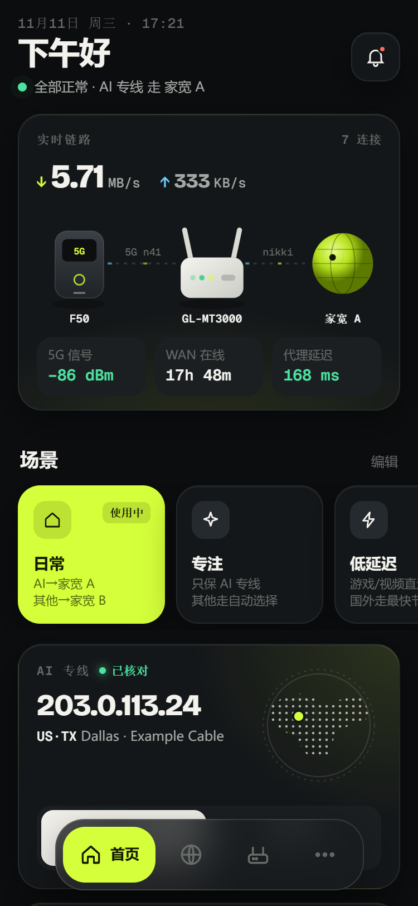
  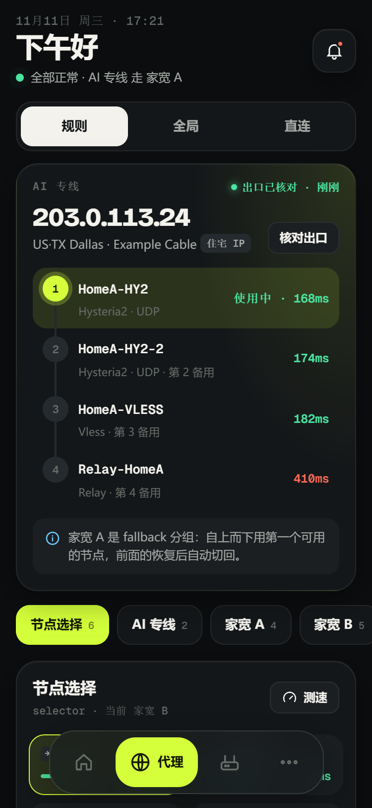
  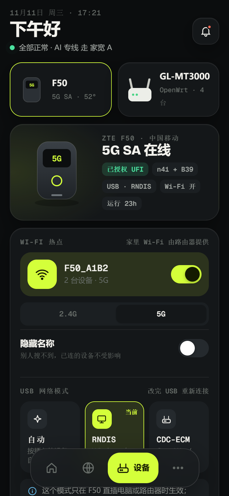
</p>

## 功能

**代理（mihomo 控制接口）**
- 切换规则 / 全局 / 直连模式，切换分组节点，分组测速
- 重点线路卡：选一个最在意的分组（比如 AI 专线），显示它走哪个节点、出口 IP 是否和期望一致；fallback 分组画成切换链
- 实时连接（按重点线路 / 代理 / 直连筛选）、断开连接、更新订阅
- “这个网址走哪里”：在 App 里按 mihomo 规则匹配，显示命中的规则和最终节点

**路由器（OpenWrt 自带的 rpcd，免安装）**
- 系统状态、WAN、在线设备；设备改名（写入 DHCP 主机名）、固定 IP
- Wi-Fi 开关和信道。改动走 OpenWrt 的“不确认就回滚”：90 秒内不点“保留”，自动恢复
- 重置 WAN、重启网络、重启路由器、生成配置备份
- 自动找到路由器上 nikki / OpenClash 的控制地址和 secret

**随身 WiFi（UFI-TOOLS）**
- 信号、温度、流量、短信
- 锁频、网络制式、移动数据（改坏了 App 会计时恢复）、USB 网络模式、Wi-Fi、漫游、指示灯、有线 ADB

**其他**
- 多套配置（家、公司…）随时切换；没有设备也可以进演示模式
- 扫码 / 粘贴导入导出配置：默认不带密码，要带密码时用口令加密
- 危险操作需要长按确认（黄黑警示条），同一时间只允许一个待确认的更改
- 深色 / 浅色跟随系统；手机单列，平板和横屏两列；省电模式

## 截图

| 首页 | 路由器 | 更多 |
|:-:|:-:|:-:|
|  | 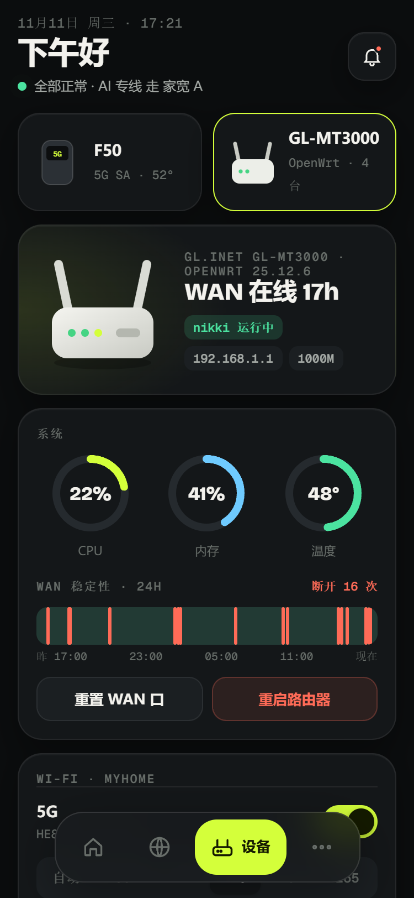 | 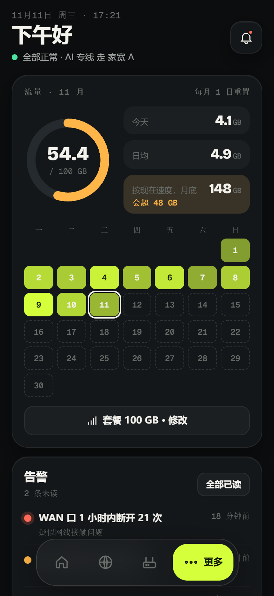 |

| 首次设置 | 公网地址警告 | 自动 / 手动连代理 |
|:-:|:-:|:-:|
| 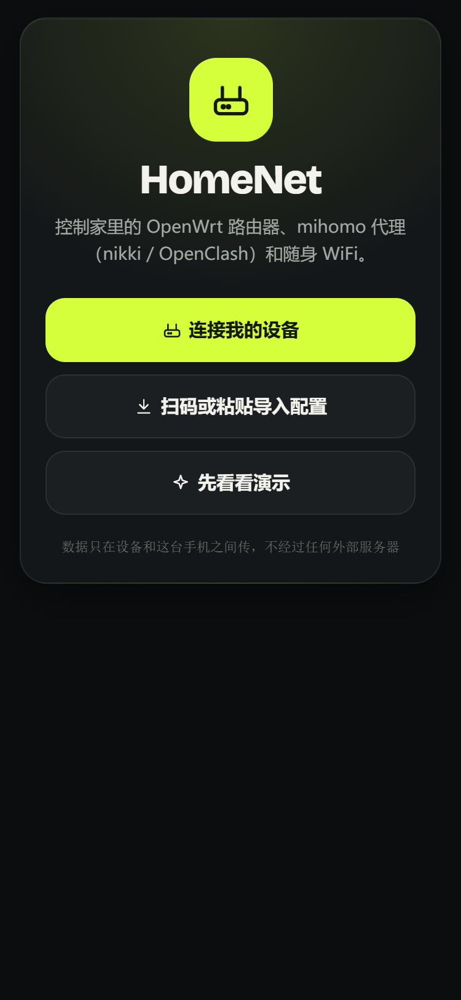 | 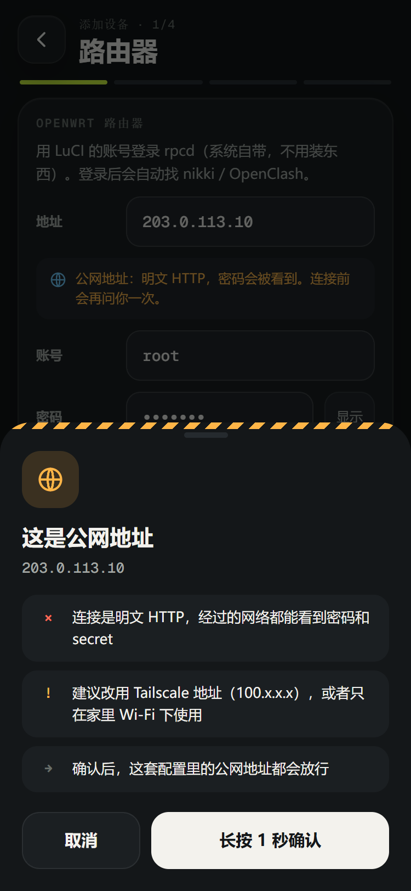 | 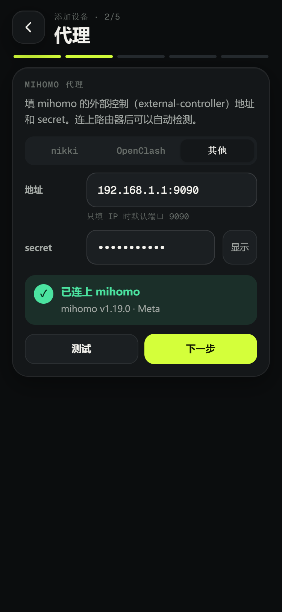 |
| **选重点线路** | **设备连不上时** | **多套配置** |
| 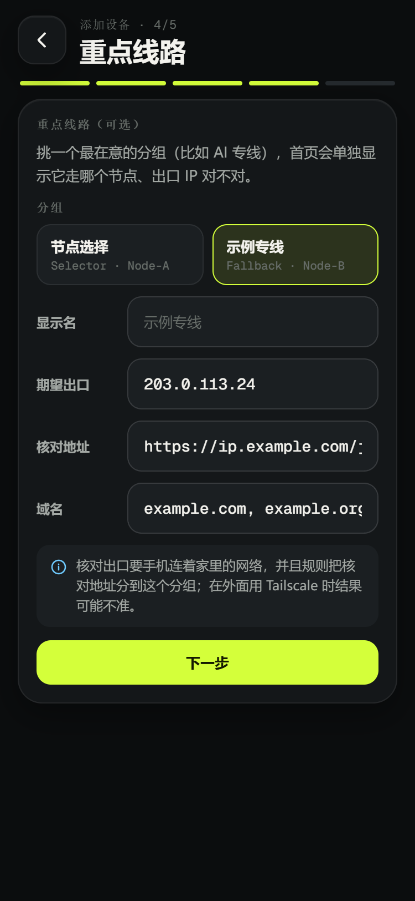 | 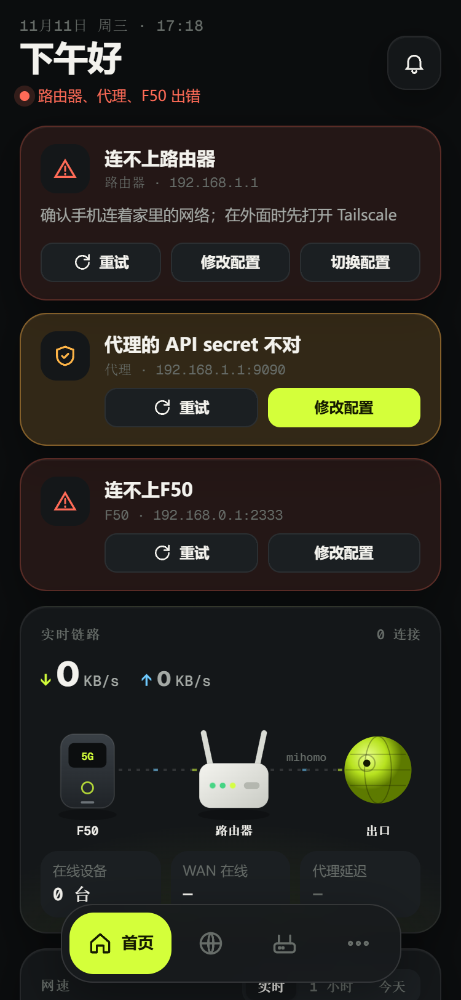 | 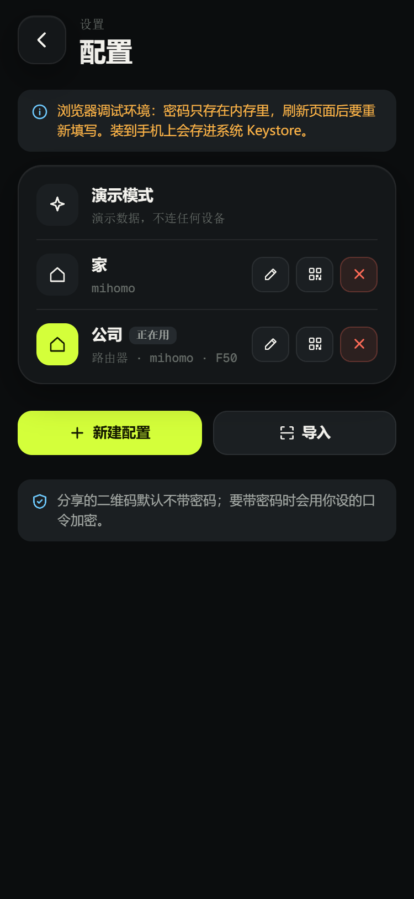 |
| **分享配置（加密二维码）** | **导入配置** | **设备改名** |
| 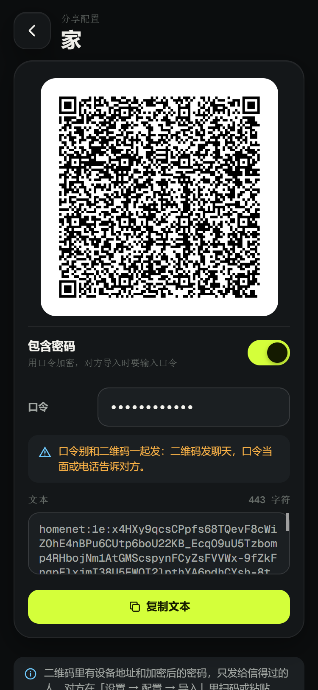 | 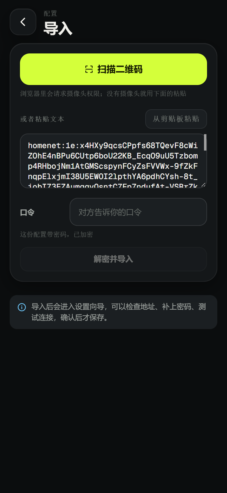 | 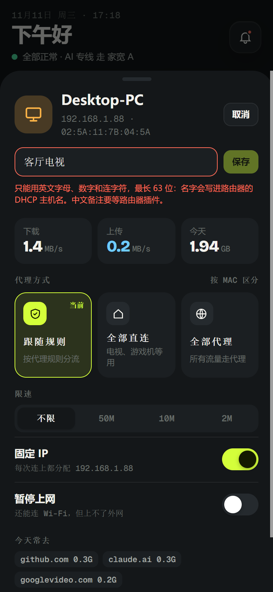 |

浅色模式：

<p>
  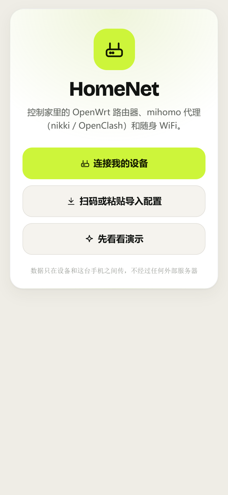
  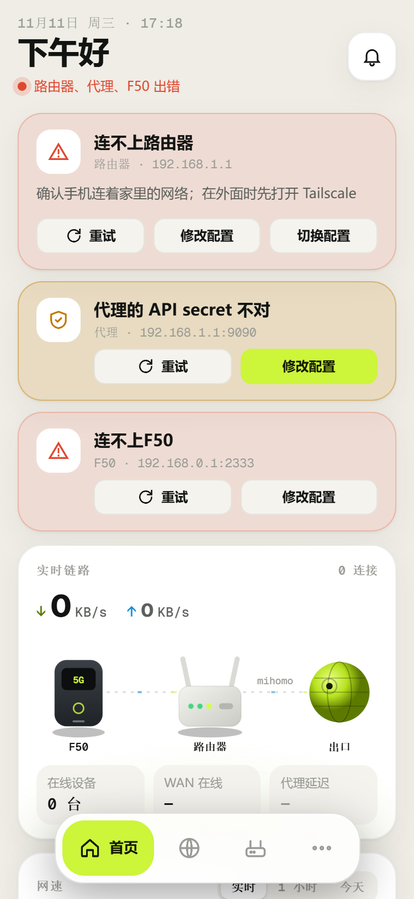
  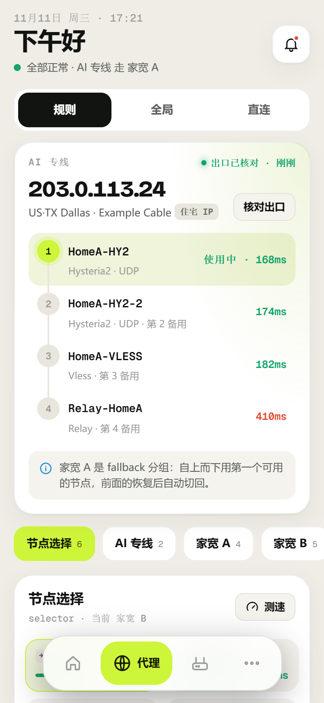
</p>

平板 / 横屏：

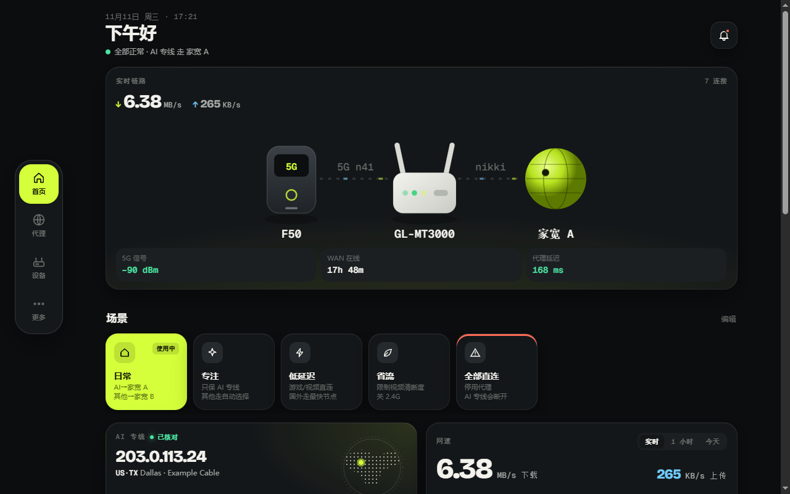

> 截图里的数据都是演示数据或本地假服务（IP 用文档保留网段和 OpenWrt 默认网段）。更多截图在 [docs/screens](docs/screens) 和 [docs/emulator](docs/emulator)（MuMu 模拟器实拍）。

## 使用

### 安装

安装 release APK（约 3.9 MB，安卓 8.0 及以上）。打包方法见下面的“开发”一节。

### 首次设置

1. 打开 App，点“连接我的设备”。没有设备可以点“先看看演示”。
2. **路由器**：填路由器地址（例如 `192.168.1.1`）和 LuCI 的账号密码（一般是 `root` 和你设的 root 密码），点“连接”。
   - 不知道地址：手机连上路由器的 Wi-Fi，在 Wi-Fi 详情里看“网关”。
3. **代理**：连上路由器后会自动读出 nikki / OpenClash 的控制地址和 secret；也可以手动填任意 mihomo 的 `external-controller` 地址（只填 IP 时默认端口 9090）。
4. **随身 WiFi**（可选）：填 UFI-TOOLS 的地址（只填 IP 时默认端口 2333）和登录口令。
5. **重点线路**（可选）：从分组里选一个，填期望出口 IP、返回出口 IP 的核对地址，以及属于这条线路的域名。
6. 保存。之后可以在“更多 → 设置 → 当前配置 · 切换”里新建、编辑、分享、删除配置。

### 路由器需要什么

- OpenWrt，装了 LuCI 就行。用到 `uhttpd-mod-ubus`、`rpcd-mod-file`、`rpcd-mod-iwinfo`、`rpcd-mod-rc`，LuCI 都会带上
- 登录账号需要 root 等效权限
- 代理：nikki、OpenClash，或任何开了外部控制接口的 mihomo

## 安全

- 密码和 secret 加密后存在安卓 Keystore 里，不以明文落盘。
- 默认只允许局域网和 Tailscale 地址（10/8、172.16/12、192.168/16、100.64/10，以及 `.lan`、`.local`、`.ts.net` 等）。填公网地址时会警告“明文 HTTP，密码会被看到”，长按确认后才放行。
- 导出的配置默认不带密码；选择带密码时，用 PBKDF2-SHA256 + AES-256-GCM 按你设的口令加密。
- 不收集任何数据，不连接开发者的服务器。

## 已知限制

- **还没在真实设备上联调**，接口字段可能需要按真机调整（清单见 PLAN.md 第 12、13 节）。
- F50 的飞行模式、隐藏 Wi-Fi 名称、测速、取消拦截系统更新：接口还没确认，界面上显示为“暂不支持”。
- 重点线路的出口核对需要手机连着家里的网络；在外面经 Tailscale 使用时结果可能不准。
- 单设备限速、暂停上网、定时任务、流量日历、场景等功能需要路由器插件，计划在 M3 完成。
- release APK 暂时用调试证书签名，正式发布前要换签名。

## 开发

### 环境

| 工具 | 版本 |
|---|---|
| Node.js | 22 及以上（Capacitor 8 要求） |
| JDK | 21（在 `android/gradle.properties` 的 `org.gradle.java.home` 里指定，不改系统环境变量） |
| Android SDK | platform 36、build-tools 35/36（路径写在 `android/local.properties`，这个文件不提交） |

技术栈：Capacitor 8 + Svelte 5 + TypeScript 6 + Vite 8；测试用 Vitest 5。

### 常用命令

```bash
npm install
```
```bash
npm run dev
```
```bash
npm test
```
```bash
npm run check
```
```bash
npm run apk:release
```

- `npm run dev` 启动开发服务器（端口 5180）。浏览器里受跨域限制连不了真设备，用演示模式看界面；密码只存在内存里。
- `npm test` 跑单元测试；真实连接器用假 HTTP 层测试（`src/lib/connectors/__tests__/fake-net.ts`）。
- `npm run check` 做 svelte-check 类型检查。
- `npm run apk:release` 构建 release APK（R8 混淆，约 3.9 MB），产物在 `android/app/build/outputs/apk/release/`。`npm run apk` 构建 debug 包（约 35 MB，只用于开发）。

### 目录

```
src/
  lib/
    types.ts            连接器接口和数据类型
    connectors/         真实连接器：http 封装、mihomo、openwrt（rpcd）、ufi（UFI-TOOLS）
    mock/               演示模式的假数据
    store.svelte.ts     全局状态：当前配置、各模块快照、健康状态
    profiles.ts         多配置持久化（密码放 Keystore）
    share.ts            配置分享文本的编码、加密、校验
    session.ts          切换配置时作废旧请求、错误文案、失败退避
    wizard.ts           设置向导的表单逻辑
    actions.ts          用户操作（确认面板 + 调连接器 + 刷新）
  ui/
    pages/              首页、代理、设备、更多
    screens/            设置向导、配置列表、导出、导入
    devices/ parts/     设备页和通用组件
android/                Capacitor 安卓工程（含自定义 FontScale 插件）
docs/                   截图
PLAN.md                 方案、进度、联调清单
```

## 路线图

- [x] M0：工程和四页界面（按设计稿还原）、演示模式、debug APK
- [x] M1：OpenWrt / mihomo / UFI-TOOLS 连接器，设置向导，多配置，Keystore，扫码导入导出
- [ ] M1 联调：真机逐项验证
- [ ] M2：回滚事务、系统通知、后台定期检查
- [ ] M3：可选的路由器插件 homectl（限速、暂停上网、定时任务、流量统计、场景）
- [ ] 发布：正式签名、应用图标、使用说明

## 许可

代码暂未指定开源许可证。内置字体 Bricolage Grotesque 和 Geist Mono 使用 SIL Open Font License 1.1，见 [public/fonts-OFL.txt](public/fonts-OFL.txt)。
